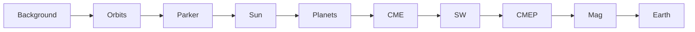
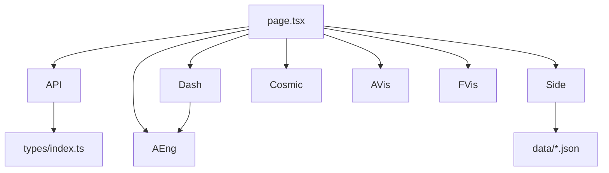

# ☀️ Solar Jukebox

> **Space weather sonification for NASA Space Apps Challenge 2026**  
> *The Earth Information Jukebox* — making solar data audible so operators *hear* the storm coming.

[](https://www.spaceappschallenge.org/)
[](https://nextjs.org/)
[](https://tonejs.github.io/)
[](https://www.typescriptlang.org/)
[](https://tailwindcss.com/)
[](https://opensource.org/licenses/MIT)

---

## 🌌 The Problem

Space weather storms — **CMEs, flares, geomagnetic storms** — threaten power grids, satellites, GPS, aviation comms, and pipelines. NOAA SWPC issues text-table alerts. Operators must *read* them while doing other tasks.

**Solar Jukebox** makes space weather **audible** — a continuous sonic representation of live solar wind, flares, CMEs, and geomagnetic response. Listen while you work; hear the storm coming.

---

## 🎵 Sonification Design

### Continuous Layers (5-layer FM Sonification)

| Layer | What It Maps To | Sound Character |
|-------|----------------|-----------------|
| **Kp Bass Pad** | Kp-index 0–9 | Subby FM pad (C2 root), modulation index 0→10, lowpass 120→2000 Hz |
| **GOES Lead Synth** | X-ray flare class (A–X) | Dual FM voices (C4 + G4 5th), FM index scales to X-flare brightness |
| **Dst Sub-Bass** | Dst index (nT) | Ultra-low rumble (15–30 Hz), amplitude tracks |Dst| storm depth |
| **CME Arpeggiator** | CME speed (km/s) | Sleek FM minor 9th arp, rate 0.2→4 Hz, lowpass 1.5→5 kHz |
| **Solar Wind Texture** | Proton flux (pfu) | Filtered brown noise density & color |

### Event-Triggered Alerts (threshold-cross)

| Alert | Trigger | Sound | Impact |
|-------|---------|-------|--------|
| **Grid Blackout** | G3+ (Kp ≥ 7) | Deep minor chord | Transformer GIC damage |
| **GPS Disruption** | G2+ (Kp ≥ 6) or M/X | Glitchy trills C7→C8 | Ionospheric scintillation |
| **Satellite Drag** | G2+ (Kp ≥ 6) | Descending glide | Thermospheric expansion |
| **Radiation Risk** | X-flare or CME >1500 | Brown noise bursts | SEP hazard |
| **Comms Blackout** | M/X flare | Stuttering square A5 | HF radio loss |

> **Design principle**: Each stream owns a distinct sonic dimension (pitch, timbre, rhythm, texture, sub-bass). The brain separates them effortlessly — you hear all five simultaneously without cognitive overload.

- **Kp Bass** maps to storm energy (fixed C2 root, FM harmonics).
- **GOES Lead** brightness maps to X-ray flare class (dual FM voices).
- **Dst Sub-Bass** amplitude maps to |Dst| storm depth.
- **CME Arp** rate maps to CME speed (sleek minor 9th pattern).
- **Solar Wind** density maps to proton flux.
- Alerts fire once per threshold cross (debounced).

---

## 🪐 Cosmic Visualization

### Canvas Layers (back → front)



| Layer | Description |
|-------|-------------|
| **Orbits** | 4 planets at actual AU distances (Mercury 0.39, Venus 0.72, Earth 1.00, Mars 1.52) |
| **Parker Spiral** | 8 rotating magnetic field lines, solar-wind driven |
| **Sun** | Radial gradient: white core → orange photosphere → red corona; pulses + blue corona on storm |
| **Planets** | Realistic size/color/distance; dynamic labels follow orbit |
| **CME Cone** | Blue transparent cone with physics-based arrival ETA label |
| **Solar Wind** | 80 blue particles deflected by magnetosphere |
| **CME Particles** | Orange bursts triggered at cone front |
| **Magnetosphere** | Multi-layer glow, magnetopause, bow shock, 4-color aurora ovals |
| **Earth** | Gradient sphere + continents, night-side terminator |

### Physics-Based CME Arrival Time

```
Distance = 1 AU = 149,600,000 km
Time (hours) = Distance / CME_Speed / 3600
```

---

## 📚 Historical Event Library

Five documented storms for guaranteed offline demo:

| Event | Date | CME | Flare | Kp | Dst | Confidence |
|-------|------|-----|-------|----|-----|------------|
| Carrington 1859 | 1–2 Sep 1859 | ~2,000 km/s | X45* | 9 | −1,600 nT | Reconstruction |
| Quebec 1989 | 13 Mar 1989 | 2,000 km/s | X15 | 9 | −589 nT | Direct |
| Halloween 2003 | 28 Oct–4 Nov 2003 | 1,850 km/s | X17.2 | 9 | −383 nT | Direct |
| May 2024 Superstorm | 10–11 May 2024 | 800 km/s | X5.8 | 8 | −412 nT | Direct |
| October 2024 Storm | 10–11 Oct 2024 | 1,100 km/s | X9.0 | 8 | −518 nT | Direct |

> *Carrington flare class estimated; Dst from ice-core proxies.

---

## 🚀 Run It

```bash
# Clone & install
git clone https://github.com/CTRLD3FEAT/Solar-Jukebox.git
cd Solar-Jukebox && npm install

# Optional: NASA API key for DONKI (NOAA endpoints work without)
echo "NEXT_PUBLIC_NASA_API_KEY=your_key" > .env.local

# Run
npm run dev  # http://localhost:3000
```

**Deploy**: Push to `main` → Vercel auto-deploys. Add `NEXT_PUBLIC_NASA_API_KEY` in Vercel settings.

▶ **Play Space Weather** (requires user gesture)  
📂 **Select historical storm** in sidebar for offline replay

---

## 📡 Data Sources

| Source | Endpoint | Data | Rate Limit | Cache |
|--------|----------|------|------------|-------|
| **NASA DONKI** | `/DONKI/CME` | CME speed, half-angle, direction, AR | 1,000 req/hr/key | 20 min localStorage |
| **NOAA SWPC** | `/planetary_k_index_1m.json` | Kp-index (1-min) | CloudFront 60s | 20 min |
| **NOAA GOES** | `/goes/primary/xrays-6-hour.json` | X-ray flux 0.1–0.8 nm | Public | 20 min |
| **Kyoto WDC** | `/dst_final/YYYYMM/` | Dst index (1-hr) | Public | 20 min |

**Attribution**: NASA DONKI · NOAA SWPC · Kyoto WDC · Tone.js

---

## 🏗️ Architecture



**Contract-first**: `SpaceWeatherEvent` — single interface for all components.

---

## ♿ Accessibility

- **ARIA live regions** for real-time updates
- **Keyboard nav**: `Tab` controls, `Space` play/mute
- **Reduced motion**: `prefers-reduced-motion` pauses animation
- **Color-blind safe**: No red/green sole encoding (tested protanopia/deuteranopia)
- **Screen readers**: All controls labeled
- **WCAG AA** contrast ratios

---

## 🎯 Submission Checklist

- [x] Live app (Vercel)
- [x] README with NASA/NOAA attribution + Quebec 1989 story
- [x] 5-event historical library (offline demo)
- [x] Live visualizer + physics-based CME ETA
- [x] 5-layer sonification + 5 threshold alerts
- [x] Accessibility audit
- [ ] 60s demo video
- [ ] 7-slide pitch deck
- [ ] NASA portal submission

---

## 🛠️ Team Handoff

| Role | Focus |
|------|-------|
| **Researcher** | Verify Carrington/Halloween data; deepen events |
| **UI/Accessibility** | Contrast, ARIA, screen-reader, reduced-motion QA |
| **Storyteller** | Portal entry, pitch deck, "Why sonification?" |
| **Demo Producer** | 60s video, final package |

---

## 📄 License

MIT — free for any use. Attribution appreciated.

---

*Built for NASA Space Apps Challenge 2026 by Team CTRLD3FEAT.*
