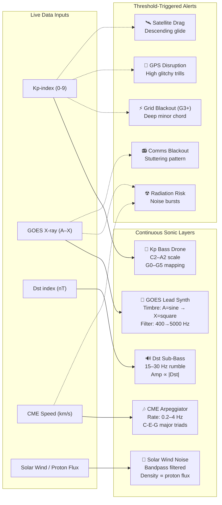
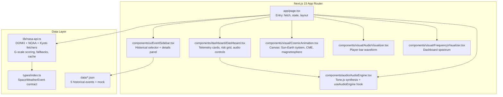

# Solar Jukebox

> **An accessible space weather sonification for the NASA Space Apps Challenge 2026**  
> *The Earth Information Jukebox* track — turning live solar data into sound so operators can **hear** the state of the grid before something goes wrong.

[](https://www.spaceappschallenge.org/)
[](https://nextjs.org/)
[](https://tonejs.github.io/)
[](https://www.typescriptlang.org/)
[](https://tailwindcss.com/)

---

## 🎯 The Problem

Space weather storms (CMEs, flares, geomagnetic storms) threaten **power grids, satellites, GPS, aviation comms, and pipelines**. NOAA SWPC issues text-table alerts. Operators must *read* them while doing other tasks.

**Solar Jukebox** makes space weather *audible* — a continuous sonic representation of live solar wind, flares, CMEs, and geomagnetic response. Listen while you work; hear the storm coming.

---

## 🎵 What You're Hearing — Sonification Design

### Audio Architecture (5 Continuous Layers + Event Alerts)



### Layer-by-Layer Mapping

| Layer | Data Source | Sonic Parameter | Mapping | Physical Meaning |
|-------|-------------|-----------------|---------|------------------|
| **Kp Bass** | NOAA Kp-index (0–9) | Pitch (C2–A2), Gain | G0=Kp0-3:C2, G1=Kp4:D2, G2=Kp5:E2, G3=Kp6:F2, G4=Kp7:G2, G5=Kp8-9:A2 | Geomagnetic storm level → power grid risk |
| **GOES Lead** | GOES X-ray class (A–X) | Oscillator type, Filter cutoff, Gain | A/B=sine, C=triangle, M=sawtooth, X=square; Filter 400→5000 Hz | Solar flare intensity → radio blackout risk |
| **Dst Rumble** | Kyoto WDC Dst (nT) | Frequency (15–30 Hz), Amplitude | Silent at -20 nT, max at -500 nT | Ring current strength → magnetosphere compression |
| **CME Arp** | DONKI CME speed (km/s) | Note rate (0.2–4 Hz) | 300 km/s=0.2 Hz → 2000 km/s=4 Hz | CME transit speed → arrival urgency |
| **Solar Wind** | NOAA proton flux (pfu) | Filter freq (200–2200 Hz), Gain | Log scale: 1→quiet, 1000→dense | Particle radiation → satellite/astronaut risk |

### Event Alerts (One-Shot on Threshold Cross)

| Alert | Trigger | Sound | Meaning |
|-------|---------|-------|---------|
| **Grid Blackout** | Kp ≥ 7 (G3+) | Deep minor chord (C2-E♭2-G2-C3…) | Power grid GIC risk — transformer damage possible |
| **GPS Disruption** | Kp ≥ 6 or M/X flare | High glitchy trills (C7–C8) | Ionospheric scintillation — precision GPS degraded |
| **Satellite Drag** | Kp ≥ 6 | Descending sawtooth (G5→C4) | Thermospheric expansion — orbital decay |
| **Radiation Risk** | X-flare or CME >1500 km/s | Brown noise bursts | SEP event — astronaut/avionics hazard |
| **Comms Blackout** | M/X flare | Stuttering square wave (A5) | HF radio blackout — aviation/maritime comms lost |

> **Design principle**: Each data stream owns a *distinct sonic dimension* (pitch, timbre, rhythm, texture, sub-bass). The brain separates them effortlessly — you hear *all five at once* without cognitive overload.

---

## 🌌 Visualization — Cosmic Animation

```mermaid
graph TB
    subgraph Canvas["Canvas Layers (back → front)"]
        BG["Background\n#E9E9E5 paper texture"]
        Orbits["Orbit Rings\n4 planets: Mercury→Mars\nActual AU distances"]
        Parker["Parker Spiral\n8 magnetic field lines\nRotating, solar-wind driven"]
        Sun["Sun\nRadial gradient: white core → orange photosphere → red corona\nPulse + blue corona on storm"]
        Planets["Planets\nRealistic size/color/distance\nDynamic labels follow orbit"]
        CME["CME Cone\nBlue transparent cone\nPhysics-based arrival ETA label"]
        SolarWind["Solar Wind Particles\n80 blue particles\nDeflected by magnetosphere"]
        CMEParticles["CME Particles\nOrange bursts\nTriggered at cone front"]
        Magnetosphere["Earth Magnetosphere\nMulti-layer: glow, magnetopause, bow shock\nAurora ovals (4 colors)"]
        Earth["Earth\nGradient sphere + continents\nNight-side terminator"]
    end

    BG --> Orbits --> Parker --> Sun --> Planets --> CME --> SolarWind --> CMEParticles --> Magnetosphere --> Earth
```



### Physics-Based CME Arrival Time

The label `CME front · arrival in Xh Ym` shows **real transit time**:

```
Distance = 1 AU = 149,600,000 km
Time (hours) = Distance / CME_Speed / 3600
```

| Event | CME Speed | Transit Time |
|-------|-----------|--------------|
| Live (current) | 327 km/s | ~127 h (5.3 days) |
| May 2024 Superstorm | 800 km/s | ~52 h (2.2 days) |
| Oct 2024 Storm | 1,100 km/s | ~38 h (1.6 days) |
| Quebec 1989 | 2,000 km/s | ~21 h (0.9 days) |
| Carrington 1859 | ~2,500+ km/s | ~17 h |

> *Animation loops continuously for visual effect; label shows actual physics-based remaining time.*

---

## 📚 Historical Event Library

Five documented storms available for offline replay (guaranteed demo):

| Event | Date | CME Speed | Flare | Kp | Dst | Confidence |
|-------|------|-----------|-------|----|-----|------------|
| Carrington 1859 | 1–2 Sep 1859 | ~2,000 km/s | X45* | 9 | −1,600 nT | Historical reconstruction |
| Quebec 1989 | 13 Mar 1989 | 2,000 km/s | X15 | 9 | −589 nT | Direct observation |
| Halloween 2003 | 28 Oct–4 Nov 2003 | 1,850 km/s | X17.2 | 9 | −383 nT | Direct observation |
| May 2024 Superstorm | 10–11 May 2024 | 800 km/s | X5.8 | 8 | −412 nT | Direct observation |
| October 2024 Storm | 10–11 Oct 2024 | 1,100 km/s | X9.0 | 8 | −518 nT | Direct observation |

> *Carrington flare class estimated from historical records; Dst from ice-core proxies.

Each event JSON includes: `cmeSpeed`, `flareClass`, `kpIndex`, `stormIntensity`, `isBlackoutRisk`, `dst`, `cmeDirection`, `cmeHalfAngle`, `flarePeakTime`, `activeRegion`, plus `_meta` with narrative, impact description, and confidence level.

---

## 🚀 Run It

```bash
# 1. Clone & install
git clone https://github.com/CTRLD3FEAT/Solar-Jukebox.git
cd Solar-Jukebox
npm install

# 2. Add NASA API key (optional — uses public NOAA endpoints without it)
echo "NEXT_PUBLIC_NASA_API_KEY=your_key_here" > .env.local

# 3. Run dev server
npm run dev
# open http://localhost:3000
```

**Deploy to Vercel**: Push to `main` → auto-deploys. Set `NEXT_PUBLIC_NASA_API_KEY` in Vercel project settings.

Click **▶ Play Space Weather** to start audio (browser requires user gesture).  
Select any historical storm in the left sidebar for offline replay.

---

## 📡 Data Sources & Attribution

| Source | Endpoint | Data | Rate Limit | Cache |
|--------|----------|------|------------|-------|
| **NASA DONKI** | `api.nasa.gov/DONKI/CME` | CME speed, half-angle, direction, active region | 1,000 req/hr per key | 20 min (localStorage) |
| **NOAA SWPC** | `services.swpc.noaa.gov/json/planetary_k_index_1m.json` | Planetary Kp-index (1-min) | CloudFront CDN, 60s cache | 20 min |
| **NOAA GOES** | `services.swpc.noaa.gov/json/goes/primary/xrays-6-hour.json` | X-ray flux (0.1–0.8 nm) | Public, no key | 20 min |
| **Kyoto WDC** | `wdc.kugi.kyoto-u.ac.jp/dst_final/YYYYMM/index.html` | Dst index (1-hour) | Public, no key | 20 min |

**Attribution**:
- NASA DONKI API: https://api.nasa.gov/
- NOAA SWPC: https://www.swpc.noaa.gov/
- Kyoto WDC: http://wdc.kugi.kyoto-u.ac.jp/
- Tone.js: https://tonejs.github.io/

---

## 🏗️ Architecture



**Contract-first design**: `SpaceWeatherEvent` is the single interface every component consumes. Teams work in parallel against this contract.

---

## ♿ Accessibility

- **ARIA live regions** for real-time data updates
- **Keyboard navigation**: `Tab` through all controls, `Space` to play/mute
- **Reduced motion**: `prefers-reduced-motion` pauses canvas animation
- **Color-blind safe**: Tested for protanopia/deuteranopia (no red/green sole encoding)
- **Screen reader labels**: All controls and data cards have `aria-label`
- **High contrast**: WCAG AA compliant text/background ratios

---

## 🎯 Submission Checklist

- [x] Live app deployed (Vercel)
- [x] README with NASA/NOAA attribution + Quebec 1989 story
- [x] 5-event historical library (offline demo guaranteed)
- [x] Live visualizer + physics-based CME arrival time
- [x] 5-layer continuous sonification + 5 threshold alerts
- [x] Accessibility audit (ARIA, keyboard, reduced motion, color-blind)
- [ ] 60-second demo video
- [ ] 7-slide pitch deck
- [ ] NASA portal submission (URL + repo + deck)

---

## 🛠️ Team Handoff

The solo-built **Engine** (data pipeline, audio core, dashboard, visualization) is complete. The team refines the **Experience**:

| Role | Tasks |
|------|-------|
| **Researcher** | Deepen historical event data; verify Carrington/Halloween values |
| **UI/Accessibility** | Contrast audit, ARIA labels, screen-reader testing, reduced-motion QA |
| **Storyteller** | NASA portal entry, pitch deck, "Why sonification?" narrative |
| **Demo Producer** | Record 60s video, submit final package |

---

## 📄 License

MIT — free for any use. Attribution appreciated.

---

*Built for NASA Space Apps Challenge 2026 by Team CTRLD3FEAT.*